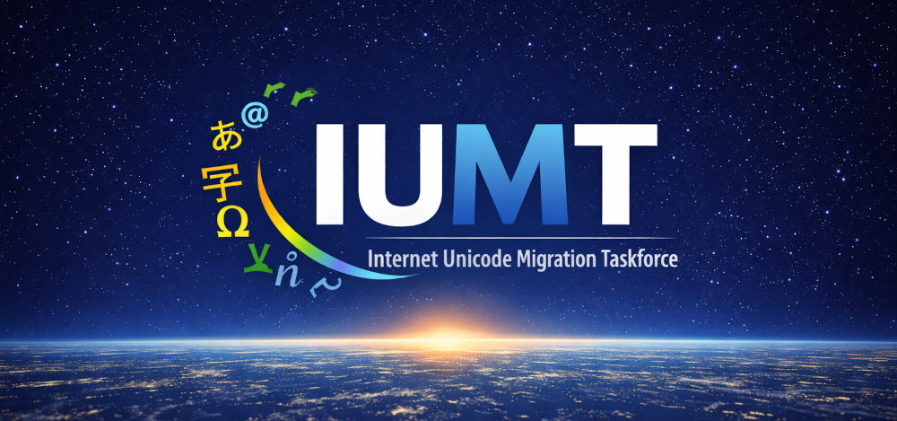

# Internet Unicode Migration Taskforce (IUMT)

**Available languages:** [English](./README.md) | [Deutsch](./README.de.md) | [Español](./README.es.md)

Willkommen bei der **Internet Unicode Migration Taskforce (IUMT)** – einer internationalen Initiative zur vollständlichen, koordinativen Umstellung des Internets auf native Unicode-Unterstützung, ohne Punycode-Zwischenlösungen.

## 🌐 Mission
Die IUMT verfolgt das Ziel, die weltweite Infrastruktur des Internets so weiterzuentwickeln, dass alle Domainnamen, E-Mail-Adressen und netzbezogenen Textsysteme Unicode nativ unterstützen – als Grundlage für eine inklusive, sprachgerechte und kulturell diverse weltweite Kommunikation.

## 🧡 Warum Unicode?
Trotz der Verbreitung von Unicode in Webinhalten ist das Domain Name System (DNS) weiterhin ASCII-basiert. IDNA/Punycode ist eine technische Übergangslösung, die langfristig nicht ausreicht:

- Punycode trennt sichtbare Namen von technischen Repräsentationen
- Viele Systeme sind nicht "universal acceptance"-fähig
- Die digitale Ausgrenzung nicht-lateinischer Schriftgemeinschaften besteht weiter

Unicode direkt im DNS würde diesen Bruch überwinden.

## ⚖️ Ziele
- Koordination eines weltweiten Standardisierungsprozesses für native Unicode-Domainnamen
- Entwicklung von Migrationsstrategien (Root-Zone, Resolver, DNSSEC, Legacy-Handling)
- Förderung von Unicode-Kompatibilität in Betriebssystemen, Libraries und Protokollen
- Internationale politische Aufklärung zur Notwendigkeit sprachgerechter Adressierbarkeit

## 🤝 Wer wir sind
Die IUMT ist ein offenes, multidisziplinäres Bündnis aus:
- Technischen Experten aus DNS, Softwareentwicklung, Netzwerktechnik
- Sprachwissenschaftler*innen und Schriftkommunikationsforschenden
- Aktivisten für digitale Inklusion und kulturelle Vielfalt
- Vertreter aus Standardisierungs- und Regulierungsinstitutionen

## ✅ Mitmachen
Wir freuen uns über Beiträge jeder Art:
- Mitwirken an Spezifikationen und RFC-Entwürfen
- Entwicklung von Unicode-fähigen Tools, Resolvern und DNS-Komponenten
- Bereitstellung von Testumgebungen, DNS-Experimenten und Root-Zonenmodellen
- Übersetzungen, politische Kommunikation, juristische Begleitung

## ⚙️ Erste Schritte
1. [iumt.org](https://iumt.org) besuchen (in Vorbereitung)
2. Im [IUMT Consensus](https://github.com/orgs/iumt/discussions) mitdiskutieren oder [GitHub Issues](https://github.com/iumt/consensus/issues) für konkrete Aufgaben und technische Probleme nutzen.
3. Beispiel-DNS-Konfigurationen mit Unicode testen (in `examples/`)
4. Manifest unterzeichnen: [`MANIFEST.md`](/docs/MANIFEST.md)

## 🚀 Vision
Ein weltweites Internet, in dem Menschen ihre digitale Identität **in ihrer eigenen Sprache und Schrift** frei und ohne technische Hürden gestalten können – vollständig Unicode-nativ, vom Root bis zur Anwendung.

> **Zeichen, die verbinden – Names that belong.**
